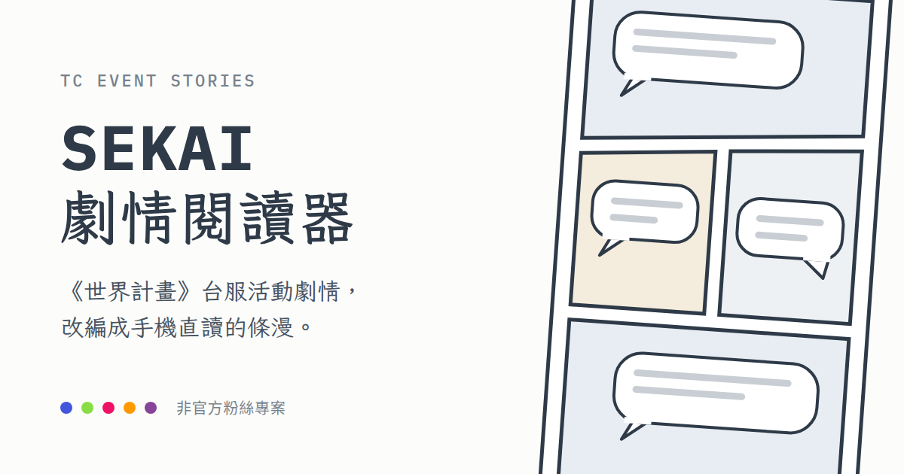

# SEKAI Story Reader

You want to catch up on a Project SEKAI (Traditional Chinese server) event story without opening the game and tapping through every line. Open the reader on your phone and each episode scrolls by as a vertical comic: real backgrounds, slanted manga panels and speech bubbles with the original dialogue.



- **AI-directed panels**: an AI director picks each panel's type, framing and slant; the dialogue is always the original text, referenced by line number only.
- **Manga vocabulary**: eight bubble shapes chosen from the line itself, focus and speed lines, sound effects and slanted gutters of equal width.
- **Every line, once**: automated tests check that every line of an episode is rendered exactly once, in order.
- **The whole library**: Taiwan-server events from the first one onward, searchable by title or character and filterable by unit, and the reader remembers where you stopped.

Events the Taiwan server has not released in Chinese yet are listed as 「尚未提供」 until their files appear.

## How it works

```
Taiwan-server event list ──► fetch one event's script and images per hour ──► private R2 store
.asset script ──► episode JSON ──────────┐
storyboard (line numbers only) ──────────┼──► comic renderer ──► static pages on Cloudflare Pages
backgrounds + chibi images ──────────────┘
```

There is no server and no database behind the page: an hourly GitHub Actions run fetches new events, asks Claude to storyboard new episodes, and uploads plain files.

## Install

You need only a phone or desktop browser.

1. Open https://sekai-reader.pages.dev.
2. On iPhone, tap **Share → Add to Home Screen** to open it like an app; on Android, use **⋮ → Add to Home screen**.
3. Pick an event from the library, then an episode.

To build or run the site yourself, see [docs/DEVELOPMENT.md](docs/DEVELOPMENT.md).

## Privacy & security

- Your browser's localStorage keeps only reading preferences: black-and-white mode, dark mode, your five most recent episodes and the scroll position in each of them.
- The page loads its own files and fonts from Google Fonts, which sees your IP address. It never contacts Sekai-World or any game server, and it has no analytics.
- The site has no accounts. The pipeline's keys live only in GitHub Actions secrets and are passed to the single step that needs each one.

## License

The source code is [MIT](LICENSE). The MIT license does not cover game content: scenario text, backgrounds, event banners and character images belong to SEGA / Colorful Palette, and the data comes from Sekai-World. This is a non-commercial fan project.
