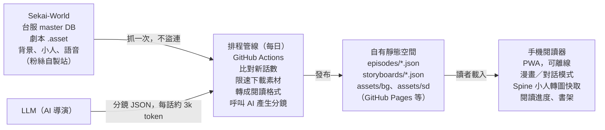

# SEKAI 劇情閱讀器 計畫書

2026-10-30

## 背景與目標

目標是做一個手機優先的《世界計畫》台服活動劇情閱讀器，讓讀者完全不用開遊戲看劇情。核心呈現方式是**漫畫模式**：官方小人（SD）擺姿勢、官方背景鋪滿格子，分鏡由 AI 導演產生。

- **使用者痛點**：遊戲內閱讀要開遊戲、找章節、看自動播放，無法搜尋或跳讀；sekai.best 是資料庫，閱讀體驗只是附帶功能。
- **目標讀者**：追更型玩家（主要）、補課的新玩家、單推型玩家；先給自己和朋友使用，不做商業化。
- **產品定位**：「世界計畫的讀者版」。閱讀器打底，之後用 AI 伴讀功能（摘要、防雷人物卡、語意搜尋）做差異化。
- **範圍**：先做台服繁中活動劇情（目前 182 期、1,498 話）。主線、卡面劇情、其他遊戲之後再說，但資料格式要預留擴充空間。

## 目前進度

原型已完成並在手機上試讀過，結論是**對話模式沉浸感太低，漫畫模式的節奏方向正確，但缺少真實畫面**。

**Demo**：[SEKAI 劇情閱讀器（原型）](https://claude.ai/artifact/UBizAtFyQXVKsqoVcHxDKn)，原始碼在交接檔案的 `demo/` 資料夾。

| 功能 | 狀態 | 備註 |
| --- | --- | --- |
| 台服活動目錄（182 期） | 完成 | 名稱、日期、團體、話數標題內嵌在頁面 |
| 載入劇本檔 | 完成 | 使用者手動下載 `.asset` 再選取，可多選；存在 localStorage |
| 對話模式 | 完成 | 場景卡、時段、回憶、內心話、手機訊息、表情小標、記憶閱讀位置 |
| 漫畫模式 | 原型 | 10 種格子；173-1 有 AI 分鏡，其他話用規則自動分鏡 |
| 角色畫面 | 占位 | 角色代表色圓圈＋首字，尚無官方圖 |
| 背景圖、語音 | 未做 | 受 Claude 頁面沙盒與 sekai.best 防盜連限制 |

**試讀回饋**：對話模式「刷一下就過去」，每句台詞大小、重量都一樣，高潮和閒聊看起來沒差。

**已修正的問題**：部分劇本檔內部的 `ScenarioId` 是錯的（`event_173_01` 檔內寫 `event_172_01`），現在改用檔名 `m_Name` 比對。

## 資料來源與格式（已驗證）

所有資料都來自粉絲自製的 Sekai-World（sekai.best 背後的專案），以下網址和欄位都已在 2026-10-30 實測。

| 資料 | 位置 | 跨站讀取 |
| --- | --- | --- |
| 台服 master DB | `https://sekai-world.github.io/sekai-master-db-tc-diff/<表>.json`，或 `raw.githubusercontent.com/Sekai-World/sekai-master-db-tc-diff/main/<表>.json` | 可以 |
| 劇本檔 | `https://storage.sekai.best/sekai-tc-assets/event_story/{assetbundleName}/scenario/{scenarioId}.asset`（內容是 JSON） | 擋外站 |
| 背景圖 | `.../sekai-jp-assets/scenario/background/{bg}/{bg}.webp`，寬 2048 px | 擋外站 |
| 小人（Spine） | `.../sekai-jp-assets/area_sd/sd_main/base_model/sd_main.skel`（共用骨架）＋ `.../area_sd/sd_main/{sd_01ichika_normal}/sekai_atlas.atlas.txt` 與 `sekai_atlas.png`（約 118 KB） | 擋外站 |
| 語音 | `.../sound/scenario/voice/{scenarioId}/{voiceId}.mp3` | 擋外站 |

**用到的 master DB 表**：`events`、`eventStories`（話數、`scenarioId`、`assetbundleName`）、`gameCharacters`、`gameCharacterUnits`（角色代表色 `colorCode`）、`character2ds`（`Character2dId` 對應角色）。其他地區把 `-tc-` 換成 `-en-`、`-kr-`、`-cn-`，日服是 `sekai-master-db-diff`。

**劇本 JSON 的重點欄位**：

- `Snippets`：演出順序。`Action`：1 台詞、2 角色站位、4 角色動作、5 選項、6 特效、7 音效、8 站位模式；`ReferenceIndex` 指向對應陣列。
- `TalkData`：`WindowDisplayName`（說話者）、`Body`（台詞）、`Motions[].FacialName`（表情，如 `face_smile_01`）、`Motions[].MotionName`（動作，如 `w-adult12-tilthead`）、`Voices[].VoiceId`。
- `SpecialEffectData.EffectType`：1/2 黑幕淡入淡出、3/4 白幕、5/6 畫面或視窗震動、7 換背景（`StringVal` 是背景 ID）、8 地點字幕、9/10 回憶開始/結束、13 傍晚、14 夜晚、18 地點資訊、20/21 進出「世界」。
- `LayoutData`：角色站位（左、中、右）與服裝 `CostumeType`。

**注意事項**：

- **台服文本延遲**：素材庫的繁中劇本只更新到第 180 期（2026-09-25）。181 到 183 期抓到的是日文原文，要偵測並標示。
- **防盜連**：`storage.sekai.best` 依 Referer 判斷，只允許 sekai.best 自己讀取。正式版**不要**用去掉 Referer 的方式盜連，改成定期抓一次存到自己的空間（見系統架構）。
- **劇本檔編號可能有錯**：以檔名 `m_Name` 為準，`ScenarioId` 只當備用。
- 劇本裡的名字帶「的訊息」後綴（例如「咲希的訊息」）代表手機訊息；「眾人」是群體台詞。

## 產品決策

主要呈現方式定為**垂直捲動的漫畫模式**；Live2D 一句一句點擊前進的劇場模式**不做**。

| 決策 | 結論 | 理由 |
| --- | --- | --- |
| 閱讀方式 | 垂直捲動漫畫（webtoon），保留對話模式當備用 | 對話模式沉浸感低；使用者不喜歡點擊前進 |
| 劇場模式（Live2D 點擊前進） | 否決 | 使用者原本就不喜歡這種閱讀方式 |
| 角色畫面 | 官方小人（Spine SD），每格依台詞自動選姿勢 | 劇本已有個性類型與表情，可規則對應 |
| 背景 | 官方背景圖鋪滿格子，AI 導演決定取景 | 補足場景感，成本低 |
| AI 生成畫面 | 暫不做，之後只考慮封面或名場面 | 每話約 36 格、全部約 5 萬張，成本高且角色不一致 |
| 分鏡 | AI 導演產生、只引用台詞編號，生成一次全體共用 | 每話約 3 千 token，成本極低 |
| 語言 | 台服繁中優先 | 使用者需求 |
| 資料來源 | 直接使用 Sekai-World 的資料，抓一次存到自己的空間 | 他們是粉絲站；不盜連，對其伺服器友善 |
| 分享範圍 | 先不公開，只給朋友網址 | 素材屬於 SEGA / Colorful Palette |

之後的 AI 伴讀功能依價值排序：每話摘要與導讀 → 依閱讀進度防雷的人物卡與問答 → 閱讀路線推薦 → 語意搜尋 → 日服搶先翻譯（只限自用）。

## 漫畫模式設計

分鏡、畫面、台詞三者分開：**AI 導演只輸出結構**（格子類型、台詞編號、音效、取景），台詞從劇本檔讀，小人姿勢用規則從劇本推得。這樣分鏡便宜、可快取，換畫面也不必重跑 AI。

### 分鏡格式

現行格式（見 `storyboards/event_173_01.json`），每格引用 `TalkData` 的索引：

```json
{"panels":[
 {"t":"est","caps":[0,1],"sfx":"沙沙","tone":"day"},
 {"t":"close","l":[3],"fx":"blush"},
 {"t":"talk","l":[18,19,20],"cut":[20]},
 {"t":"impact","l":[32]},
 {"t":"reveal","l":[38],"big":"quote"},
 {"t":"shout","l":[46],"cast":["一歌","咲希","穗波","志步"]}
]}
```

- `l` 台詞索引；`caps` 是第幾個場景字幕（依劇本出現順序）；`cut` 被打斷的台詞；`fx` 特效（`blush`、`sparkle`）；`tone` 色調（`day`、`office`、`serious`）；`big` 從台詞抽大字（`quote` 取「」內文字、`num` 取數字）；`cast` 群體台詞的出場角色。
- **下一版要加的欄位**：`cam`（取景：`{"focus":[x,y],"zoom":1.4}`，背景裁切的中心點與倍率）、`pose`（覆寫某句的小人姿勢）、`bg`（換場時用的背景 ID，預設取劇本 `EffectType 7`）。
- 規則：每句台詞剛好出現一次，不得遺漏或重複（173-1 已驗證 49 句全數涵蓋）。

### 格子類型

| 類型 | 用途 | 173-1 範例 |
| --- | --- | --- |
| `est` 場景 | 換場開頭，地點字幕＋音效 | 午休的中庭，「沙沙」翻頁聲 |
| `talk` 對話 | 一般對話，1–3 個對白框 | 閒聊段落 |
| `close` 特寫 | 單一角色情緒，背景帶角色色 | 穗波害羞 |
| `pop` 興奮 | 放射線底、大字對白 | 「第一次登上雜誌封面」 |
| `beat` 停頓 | 小格，短反應或吐槽 | 志步「對啦對啦。」 |
| `insert` 插入 | 唸出的文字，做成剪貼 | 雜誌介紹文 |
| `sfx` 音效 | 音效字打斷對話 | 上課鐘「噹——噹——」 |
| `trans` 換場 | 黑色帶狀時間字幕 | 「幾小時後」 |
| `impact` 衝擊 | 全黑集中線，全話高潮 | 宣布專場 LIVE |
| `split` 反應 | 兩格並排的同時反應 | 一歌與咲希 |
| `reveal` 揭曉 | 大字顯示關鍵名詞或數字 | 「TONE BASE澀谷」「1500」 |
| `shout` 齊聲 | 爆炸對白框＋全員 | 眾人「好的！」 |
| `mono` 心聲 | 旁白框，去掉括號 | 結尾穗波的獨白 |

### 小人姿勢自動對應

官方小人共用骨架 `sd_main.skel`，動作約 300 種，名稱格式是 `{性別}_{個性}_{情緒}{編號}_f`，例如 `w_adult_surprise01_f`。劇本每句都有對應線索：

- **個性**：取自 `MotionName`，如 `w-adult12-tilthead` → `w`、`adult`。已知個性有 `adult`、`cool`、`cute`、`happy`、`normal`、`pure`，以及 `kohaneunit`、`emucloth`、`nenecloth` 等角色專屬類型。
- **情緒**：取自 `FacialName`。建議對應：`smile` → `joy`、`laugh` → `laugh`、`trouble` / `doubt` → `doubt`、`surprise` → `surprise`、`sad` → `sad`、`angry` → `angry`、`smallmouth` / `normal` → `talk`；沒說話的同格角色用 `listen`，否則 `idle`。
- **後備**：找不到的組合依序退到 `{性別}_{個性}_idle01_f`、`w_normal_talk01_f`。每個角色的可用動作要實際列舉驗證。
- 小人每角色只有一套服裝，活動服不會反映；解析度偏小，大特寫格之後可改用 Live2D 截圖。

### 背景與取景

背景圖寬 2048 px，以 `object-fit: cover` 鋪滿格子，`cam.focus` 決定裁切中心，`cam.zoom` 決定拉近程度。同一場景連續幾格移動取景，就有鏡頭推移感；特寫格放大並加模糊，讓小人跳出來。

### 視覺系統

延續原型的設定：漫畫格 2.5 px 墨線框、網點底（`radial-gradient` 6 px 間距）、對白框白底黑字（深色模式也維持白底）、思考框點線、爆炸框用 `clip-path` 星形多邊形加 `drop-shadow` 描邊。字體為霞鶩文楷 TC（標題、字幕、旁白）與 Noto Sans TC（台詞）。所有顏色走 CSS 變數，支援淺色與深色。

## 系統架構與實作計畫

做成**純靜態網站加每日排程**，不需要後端伺服器：排程把新劇本和素材抓一次、轉格式、產生分鏡，閱讀器只讀自己空間裡的檔案。



分鏡每話只生成一次、所有讀者共用，所以 AI 成本只跟話數有關，跟讀者人數無關。

### 分階段實作

1. **專案骨架**：Vite + TypeScript 靜態站。從 `demo/reader.template.html` 移植劇本解析、對話模式、漫畫模式。定義閱讀用的 episode JSON（精簡台詞，保留 `r` 索引、表情、`MotionName` 個性、背景 ID、場景與特效）。
    - 驗收：本機用 173-1 跑出和原型相同的漫畫。
2. **資料管線**：GitHub Actions 每日執行。下載台服 master DB → 找出新話數 → 抓劇本（每檔間隔至少 1 秒、失敗重試）→ 轉 episode JSON → 假名比例超過 15% 標記為日文 → 只抓新出現的背景與小人 → 提交並發布。
    - 驗收：1,498 話全數轉換；重跑不會重抓已有檔案。
3. **真實畫面**：背景鋪滿格子並套用 `cam` 取景；用 Spine 執行環境（版本必須對應 `sd_main.skel` 的格式，先確認）把小人畫到離屏 canvas，轉成圖片快取；實作姿勢對應表與後備規則。
    - 驗收：173-1 每格都有正確背景與小人，手機上捲動流暢。
4. **AI 導演**：寫分鏡提示詞與 JSON schema，驗證每句台詞剛好出現一次，失敗就退回規則分鏡。先跑一期活動比對品質，再批次跑全部。
    - 成本：每話輸入約 2–3 千、輸出約 500 token；全部 1,498 話一次約 400–500 萬 token（中文切分方式有誤差）。
5. **閱讀體驗**：書架、閱讀進度、追更提醒、PWA 離線閱讀，語音播放為選配。
6. **AI 伴讀**：每話摘要、依進度防雷的人物卡與問答、語意搜尋。

## 風險與待決事項

最大的風險是素材權利：劇本與圖檔屬於 SEGA / Colorful Palette，分享越公開，被要求下架的機率越高。

| 風險 | 影響 | 對策 |
| --- | --- | --- |
| 權利人要求下架 | 網站停擺 | 不公開、只給朋友網址；不放廣告、不收費 |
| Sekai-World 停止服務或改變路徑 | 新劇本斷更 | 管線偵測錯誤並通知；備案是從官方遊戲 CDN 下載素材的開源工具 |
| 台服繁中文本同步延遲 | 最新幾期只有日文 | 標示「目前僅日文」；之後可評估自用的機器翻譯 |
| 劇本檔欄位錯誤或格式變動 | 話數錯置、解析失敗 | 以 `m_Name` 為準；解析加驗證與單元測試 |
| Spine 版本不相容 | 小人無法顯示 | 實作前先確認 `sd_main.skel` 的 Spine 版本 |
| 手機效能 | 捲動卡頓 | 小人預先轉成靜態圖並快取，只維持一個 WebGL context |

**待決事項**

- [ ] 專案放在 GitHub repo 還是本機資料夾？（建議 GitHub，方便用 Actions 與 Pages）
- [ ] 靜態空間用 GitHub Pages 還是 Cloudflare Pages？素材總量要先估算。
- [ ] 網站是否加密碼或只用不公開網址？
- [ ] AI 導演用哪個模型、API 金鑰放哪裡（Actions secret）。
- [ ] 大特寫格是否改用 Live2D 截圖。

## 交接檔案與起手指示

交接包是 `sekai-reader-handoff.zip`，解壓後放進新 repo 即可開工。所有腳本都在 2026-10-30 實際跑過一次。

| 路徑 | 內容 |
| --- | --- |
| `PLAN.md` | 這份計畫書 |
| `README.md` | 交接包說明、快速驗證指令 |
| `demo/reader.template.html` | 原型原始碼：劇本解析、對話模式、漫畫模式、規則分鏡 |
| `demo/sekai-reader.html` | 組好的原型，可直接用瀏覽器開啟 |
| `data/tc-event-index.json` | 台服活動目錄：182 期、1,498 話 |
| `storyboards/event_173_01.json` | AI 導演分鏡範例：36 格、49 句全數涵蓋 |
| `prompts/storyboard_director.md` | AI 導演提示詞草稿與驗證規則 |
| `scripts/build_index.py` | 從台服 master DB 重建活動目錄 |
| `scripts/compact_script.py` | 劇本轉成 AI 導演讀的精簡格式 |
| `scripts/build_demo.py` | 用模板、目錄、分鏡重組原型 |
| `tests/render_check.js` | 無頭檢查：每句台詞在漫畫模式剛好出現一次 |

劇本檔沒有放進交接包。測試用的 173-1 從 `https://storage.sekai.best/sekai-tc-assets/event_story/event_unsteady_2025/scenario/event_173_01.asset` 下載。

**給 Claude Code 的起手指示**

1. 先讀「資料來源與格式」「漫畫模式設計」「系統架構與實作計畫」三節。
2. 從第 1 階段開始：建立 Vite + TypeScript 專案，把原型的 `parseScenario`、`renderChat`、`renderComic`、`autoBoard` 拆成模組，把 `render_check.js` 改成正式測試。
3. 正式版不要從瀏覽器盜連 `storage.sekai.best`，素材由排程抓一次存到自己的空間。
4. 以檔名 `m_Name` 判斷話數，不信任 `ScenarioId`。
5. 開工前先問使用者「待決事項」裡的 repo 位置與部署平台。

## 參考來源

| 專案 | 可參考之處 |
| --- | --- |
| [Sekai Viewer（sekai.best）](https://github.com/Sekai-World/sekai-viewer) | 資料來源；劇本解析、Live2D 與小人（Chibi）閱讀器的實作。GPL-3.0，直接複製程式碼需跟著 GPL |
| [Sekai-World 台服 master DB](https://github.com/Sekai-World/sekai-master-db-tc-diff) | 活動、話數、角色資料 |
| [Arknights Story Text Reader](https://github.com/050644zf/ArknightsStoryTextReader) | 最接近的架構：GitHub Actions 從資料倉庫產生劇情 JSON，閱讀器讀靜態檔，支援多伺服器 |
| [MySekaiStoryteller](https://github.com/Untitled-Story/MySekaiStoryteller) | 世界計畫風格的片段式劇本結構、PixiJS 渲染 Live2D。GPL-3.0 |
| [pixi-live2d-display](https://github.com/guansss/pixi-live2d-display) | 網頁播放 Live2D，之後大特寫格可能用到 |
| [bd2wg](https://github.com/fltli/bd2wg) | 把 Bestdori 劇本轉進 WebGAL：先轉通用格式再交給播放器的思路 |
| [SEKAI Stories](https://gitea.com/idkkbroo/SEKAI-Stories) | 同人對話產生器，使用 Sekai Viewer 的背景與 Live2D |
| [comimi](https://github.com/yui540/comimi) | 漫畫閱讀器的手勢與閱讀位置記憶設計，MIT |
| [MangaFlow（EMNLP 2026）](https://aclanthology.org/2026.emnlp-main.263/) | 文字轉漫畫的學術流程：故事拆解、角色定錨、版面、嵌字 |
| [世界計畫二次創作指南](https://gamebiz.jp/news/277801) | 官方允許的二次創作範圍；虛擬歌手另受 Piapro 授權規範 |

實測過的網址與欄位以「資料來源與格式」一節為準。
